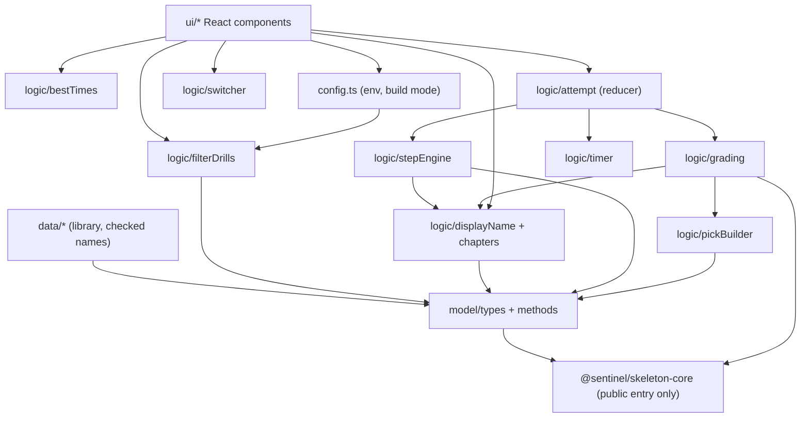
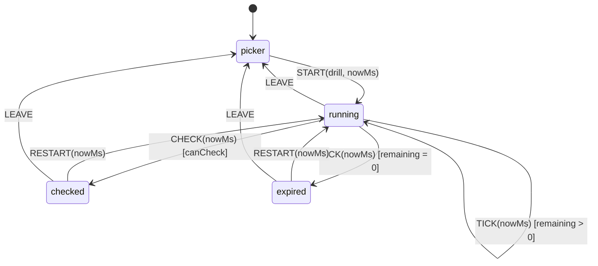
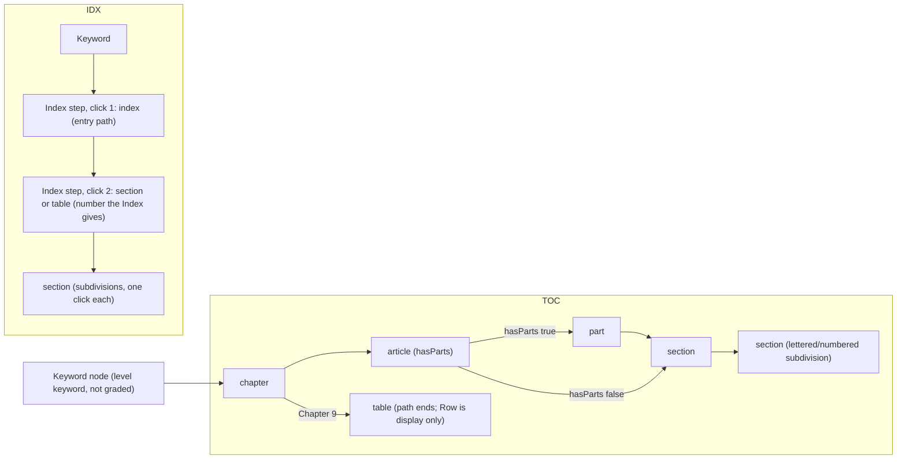

# Design Document: midnight-code-hunt

## Overview

`midnight-code-hunt/` is App 1 of sentinel-skeleton: a static React + Vite + Tailwind + TypeScript single-page app. The user picks a drill, reads one exam-style question, and works against a 120-second countdown using one of two methods: **Index Keyword Lookup** (the main method, listed first, selected by default) or **Table of Contents Lookup** (the second method). The app grades the path with `gradeTrail` from `@sentinel/skeleton-core` and shows the result as a code-path trail.

The design rests on four ideas:

1. **All decisions live in pure functions.** Filtering drills, resolving display names, advancing the step flow, building picks, adapting to `gradeTrail`, timing, best-time updates, and URL validation are pure (or take an injected dependency). React components only render their results and dispatch events.
2. **The Core is used exactly as built.** The app never edits `packages/skeleton-core`. It reads `CodeTrailDef`, `CodeTrail`, `UserPick`, `DrillDef`, `GradeResult`, `validateCodeTrail`, `gradeTrail`, `extractFirstNumber`, `NO_PARTS`, `defineCodeTrail`, and `TableValue` through the public entry point only.
3. **A drill has two views of one route set.** The Core `CodeTrailDef` holds the *declared valid trails* (what is correct). The app-level **Option_Tree** holds *what the user can click* (correct options plus wrong options). A data test proves the two views agree, so the tree can never offer a correct route that the Core would not grade as `matched`, and every declared trail is reachable.
4. **No drill content is written here.** This document and its fixtures contain no real question, answer, trail, Index entry, or NEC citation. Every NEC number that appears below is an illustrative example only and is unverified until the founder confirms it against the founder's NFPA 2026 source. Fixtures are fictional and live in a test-only folder.

Constraints from the steering files that shape the design: no runtime AI, no backend, no network calls, static deploy on Vercel, Vitest plus fast-check for tests, and a Sentinel dark theme (background `#050607`, primary `oklch(0.83 0.185 88)`).

### Scope boundary

Out of scope: any change to `packages/skeleton-core`, any drill content, and any special Annex or Article 90 screen (the data model supports those trails; no dedicated UI is built until a drill needs one, per Requirement 2.17).

---

## Architecture

### Package layout

```
midnight-code-hunt/
├── index.html                    # lang="en", viewport meta (no zoom lock), root div
├── package.json
├── tsconfig.json
├── vite.config.ts                # React + Tailwind plugins, Vitest config, core alias
├── .env.example                  # VITE_DEAD_CIRCUIT_CHECK_URL=
├── scripts/
│   ├── check-static.mjs          # network-call, deep-import, test-import, fast-check-import scan
│   └── check-bundle.mjs          # scans dist/ for fast-check
├── src/
│   ├── main.tsx                  # mounts <App/>
│   ├── App.tsx                   # providers + screen switch
│   ├── vite-env.d.ts             # ImportMetaEnv with VITE_DEAD_CIRCUIT_CHECK_URL
│   ├── config.ts                 # reads env once; exports SWITCHER_URL, BUILD_MODE
│   ├── copy/
│   │   └── strings.ts            # ALL user-facing copy (PROSE vs FIXED), footer constant
│   ├── styles/
│   │   ├── theme.css             # @theme tokens: the only place color tokens are defined
│   │   └── index.css             # @import "tailwindcss"; reduced-motion rule; focus ring
│   ├── model/
│   │   ├── types.ts              # DrillRecord, OptionNode, CheckedNames, MethodId, results
│   │   └── methods.ts            # METHOD_LABELS, methodOf(trail), availableMethods(drill)
│   ├── data/
│   │   ├── drillLibrary.ts       # export const DRILL_LIBRARY: readonly DrillRecord[] = []
│   │   ├── checkedNames2023.ts   # Checked_Names_File for 2023
│   │   ├── checkedNames2026.ts   # Checked_Names_File for 2026
│   │   └── validateDrillData.ts  # pure validator used by the data test (not imported by the app)
│   ├── logic/
│   │   ├── filterDrills.ts
│   │   ├── displayName.ts        # buildNamesIndex, resolveDisplay
│   │   ├── chapters.ts           # CHAPTER_LABELS, completeChapterOptions
│   │   ├── stepEngine.ts
│   │   ├── pickBuilder.ts
│   │   ├── grading.ts            # selectGradingInput, gradeAttempt, buildResultModel
│   │   ├── timer.ts              # Clock, remainingSeconds, formatTime, parseTime, announcementFor
│   │   ├── attempt.ts            # attempt reducer (state machine)
│   │   ├── bestTimes.ts          # updateBest, parseStoredSeconds, createBestTimesStore
│   │   └── switcher.ts           # parseSwitcherUrl
│   └── ui/
│       ├── providers.tsx         # ClockContext, BestTimesContext, NamesContext, AnnouncerContext
│       ├── Shell.tsx             # h1 slot, SwitcherLink, Footer, LiveRegion, Motifs
│       ├── DrillPicker.tsx
│       ├── DrillScreen.tsx
│       ├── MethodSelector.tsx
│       ├── StepFlow.tsx
│       ├── TimerDisplay.tsx      # + useCountdown hook
│       ├── ResultScreen.tsx
│       ├── Footer.tsx
│       ├── SwitcherLink.tsx
│       └── motifs/ (Moon.tsx, Bat.tsx, Cobweb.tsx)   # inline SVG
└── test/
    ├── support/
    │   ├── setup.ts              # jest-dom matchers, RTL cleanup
    │   ├── fakeClock.ts          # createFakeClock()
    │   ├── arbitraries.ts        # fast-check generators (trails, trees, drills, storage)
    │   ├── buildTree.ts          # treeFromTrails(): derive a consistent Option_Tree
    │   ├── bannedTerms.ts        # the ONLY file holding the banned-term list (excluded from scan)
    │   ├── readingLevel.ts       # Flesch-Kincaid grade + average sentence length
    │   └── contrast.ts           # WCAG ratio from oklch/hex
    ├── fixtures/                 # fictional drills + fictional names files (never imported by src/)
    ├── data/drillData.test.ts    # data test over DRILL_LIBRARY and fixtures
    └── content/                  # content-scan, reading-level, token-once, contrast tests
```

Unit and property tests for `src/logic/*` are co-located as `src/logic/<module>.test.ts`; component tests as `src/ui/<Component>.test.tsx`. Production code never imports from `test/` (enforced by `check-static.mjs`).

### Module dependencies



`logic/*` modules import no React, no DOM, and no `localStorage` directly (the best-times store receives a storage object). Only `ui/*` and `config.ts` touch the DOM, `import.meta.env`, `performance`, or `window`.

### How `@sentinel/skeleton-core` resolves

The Core's `package.json` exports point at `dist/`, and `dist/` is not committed. In a fresh clone, after only `npm install` at the repository root, npm links `node_modules/@sentinel/skeleton-core` to `packages/skeleton-core`, but `dist/` does not exist yet. A plain package import would therefore fail in `dev`, `test`, and `typecheck` until someone builds the Core.

Decision: the app resolves the Core's public entry (`packages/skeleton-core/src/index.ts`) through a single alias declared in two config files, so no Core build is required:

```typescript
// vite.config.ts (excerpt) — serves vite dev, vite build, and vitest
import { fileURLToPath } from "node:url";
const coreEntry = fileURLToPath(
  new URL("../packages/skeleton-core/src/index.ts", import.meta.url),
);
export default defineConfig({
  resolve: { alias: { "@sentinel/skeleton-core": coreEntry } },
  // ...
});
```

```jsonc
// tsconfig.json (excerpt) — serves tsc --noEmit
{
  "compilerOptions": {
    "paths": { "@sentinel/skeleton-core": ["../packages/skeleton-core/src/index.ts"] }
  }
}
```

Consequences:

- Source files in the app import only `"@sentinel/skeleton-core"`. The alias targets the public barrel `index.ts`, which does not export `runInvariants`, so the production bundle cannot reach `fast-check` through the Core. The `check-static` script rejects any app import whose specifier contains `skeleton-core/` or `packages/skeleton-core` (Requirement 1.6); only the two config files name the path.
- The app does not need the Core built. `npm run verify -w midnight-code-hunt` works in a fresh clone after `npm install`.
- The Core's source uses `.js` specifiers for `.ts` files (NodeNext style). Vite, Vitest, and `moduleResolution: "Bundler"` all resolve those, so no Core change is needed.
- `tsc` type-checks the Core's source files through the alias using the app's compiler options. The app therefore must not enable `noUncheckedIndexedAccess` or `exactOptionalPropertyTypes`, which the Core was not written against.
- Root ordering: the root `workspaces` array is `["packages/*", "midnight-code-hunt"]`, and root `verify` is `npm run verify --workspaces --if-present`. The Core's `verify` therefore runs first and builds `dist/`, but the app does not depend on that ordering. The app declares `"@sentinel/skeleton-core": "0.1.0"` in `dependencies` so the workspace link exists and the dependency is visible to tooling.

### Build, scripts, and pinned versions

```jsonc
// midnight-code-hunt/package.json
{
  "name": "midnight-code-hunt",
  "version": "0.1.0",
  "private": true,
  "type": "module",
  "scripts": {
    "dev": "vite",
    "build": "vite build",
    "typecheck": "tsc -p tsconfig.json --noEmit",
    "check:static": "node scripts/check-static.mjs",
    "check:bundle": "node scripts/check-bundle.mjs",
    "test": "vitest --run",
    "verify": "npm run typecheck && npm run check:static && npm run test && npm run build && npm run check:bundle"
  },
  "dependencies": {
    "@sentinel/skeleton-core": "0.1.0",
    "react": "19.3.1",
    "react-dom": "19.3.1"
  },
  "devDependencies": {
    "@tailwindcss/vite": "4.3.5",
    "@testing-library/dom": "10.4.2",
    "@testing-library/jest-dom": "6.9.1",
    "@testing-library/react": "16.3.3",
    "@testing-library/user-event": "14.6.9",
    "@types/node": "20.19.43",
    "@types/react": "19.3.0",
    "@types/react-dom": "19.3.0",
    "@vitejs/plugin-react": "5.2.0",
    "fast-check": "4.10.2",
    "jsdom": "27.4.0",
    "tailwindcss": "4.3.5",
    "typescript": "5.9.3",
    "vite": "7.3.8",
    "vitest": "3.2.7"
  }
}
```

Version notes (checked against the npm registry while writing this design; re-check at install time):

- `typescript`, `vitest`, `fast-check`, and `vite` match the versions already installed at the repository root, so the lockfile does not fork them.
- `@vitejs/plugin-react` 6.x needs Vite 8; 5.2.0 supports Vite 7, so 5.2.0 is pinned.
- `jsdom` 31 requires Node 22.22 or newer; the development machine runs Node 20.20, so `jsdom` 27.4.0 (Node `^20.19`) is pinned.
- `@testing-library/jest-dom` 7 requires Node 22; 6.9.1 is pinned.
- `vitest` and `fast-check` appear in `devDependencies` only (Requirement 1.3).

The root `package.json` change is one line: `"workspaces": ["packages/*", "midnight-code-hunt"]`. The root `verify` script is unchanged.

`vite.config.ts` also sets `build.modulePreload.polyfill = false` so the generated bundle contains no `fetch`-based preload helper, keeping the static output free of network primitives. Production builds use Vite's default `production` mode; `getBuildMode` (below) treats `import.meta.env.PROD` as production regardless of `--mode`, so a custom mode cannot publish drafts.

### The `verify` pipeline

Order is fixed and every step is a hard gate (`&&` chain; any non-zero exit stops the chain and `verify` exits non-zero, satisfying Requirement 1.12):

1. `typecheck`: `tsc --noEmit` over `src/`, `test/`, and `vite.config.ts`.
2. `check:static`: fast, file-system-only checks (below).
3. `test`: `vitest --run` (unit, property, component, data, and content tests).
4. `build`: `vite build` to `dist/`.
5. `check:bundle`: scans `dist/` for `fast-check` (Requirement 1.9).

`scripts/check-static.mjs` walks `src/` and fails with the path of each offending file:

| Check | Pattern (in any file under `src/`) | Requirement |
|---|---|---|
| Network primitives | whole-word `fetch`, `XMLHttpRequest`, `WebSocket`, `sendBeacon` | 1.11, 1.10 |
| Deep Core import | import specifier containing `skeleton-core/` or `packages/skeleton-core` | 1.6 |
| Test code in production | import specifier resolving into `test/` or `fixtures` | 17.19 |
| fast-check in production | import of `fast-check` from a non-test file | 1.3, 1.9 |

The comment rule follows from the first row: no file under `src/`, comments included, may contain those four words. Docs inside `src/` therefore say "network call".

### Attempt state machine

A drill attempt is a pure reducer (`logic/attempt.ts`). The clock is outside the reducer: the UI reads `Clock.nowMs()` and passes the reading in the event payload, so reducer tests need no timers.



`LEAVE` from `running` stores nothing: no best time is saved and no result exists (Requirement 7.8). In `checked` and `expired`, `PICK`, `SELECT_METHOD`, and `CHECK` are ignored, which disables all step choices (Requirement 7.5).

---

## Components and Interfaces

All pure-logic signatures below are exact; React components are described by props and behavior.

### 1. Core types used by the app

From `packages/skeleton-core/src` (unchanged): `TrailLevel` (`"chapter" | "article" | "part" | "section" | "table" | "notes" | "annex" | "index"`), `TrailStep`, `TrailLeg`, `CodeTrail`, `CodeTrailDef`, `TableValue`, `UserPick = { level: TrailLevel; value: string }`, `DrillDef = { trails: readonly [CodeTrail, ...CodeTrail[]]; movedFrom?: CodeTrail }`, `GradeResult = { stepResults: StepResult[]; matched: boolean; matchedMovedFrom: boolean }`, `StepResult = { level: TrailLevel; verdict: "correct" | "incorrect" | "unanswered" }`, `NO_PARTS`, `validateCodeTrail`, `gradeTrail`, `extractFirstNumber`, `defineCodeTrail`.

Core behaviors the design depends on (read from `grade.ts` and `validate.ts`):

- `gradeTrail` compares values after `trim().toLowerCase()`.
- It flattens a trail's legs and compares picks position by position. It returns `matched: true` only when every step is correct and the pick count equals the step count.
- For a trail with no `"part"` step it drops every `"part"` pick before comparing. If any dropped pick is not the value `NO_PARTS`, it inserts one synthetic `{ level: "part", verdict: "incorrect" }` entry and `matched` is false. The app never produces `NO_PARTS`, so any Part pick on a part-less trail is a misfire.
- `matchedMovedFrom` is true only when no valid trail matched and `movedFrom` matched.
- `gradeTrail` does not say which trail produced `stepResults` (see Design notes and risks).
- `validateCodeTrail(def)` validates `trails`, `movedFrom`, and `editionNote` length. An Index leg is `index` then one or more `section` or `table` steps; Chapter 9 is `chapter` then `table`.

### 2. Methods (`src/model/methods.ts`)

```typescript
import type { CodeTrail } from "@sentinel/skeleton-core";
import type { DrillRecord, MethodId } from "./types";

export const METHOD_ORDER: readonly MethodId[] = ["index", "toc"]; // index always first
export const METHOD_LABELS: Readonly<Record<MethodId, string>> = {
  index: "Index Keyword Lookup",
  toc: "Table of Contents Lookup",
};

/** Req 2.8: method from the level of the first step of the first leg. */
export function methodOf(trail: CodeTrail): MethodId; // "index" -> "index"; chapter|annex|article -> "toc"

/** Req 6.2-6.4: methods offered for a drill, index first. */
export function availableMethods(drill: DrillRecord): readonly MethodId[];
// index_checked && trees.index defined  -> ["index", "toc"]
// otherwise                              -> ["toc"]

export function defaultMethod(drill: DrillRecord): MethodId; // availableMethods(drill)[0]
```

### 3. Filtering (`src/logic/filterDrills.ts`)

```typescript
export type BuildMode = "production" | "development" | "test";
export type DrillEntry = { readonly drill: DrillRecord; readonly draft: boolean };

/** Maps Vite env to a BuildMode. PROD wins, so a custom --mode cannot publish drafts. */
export function getBuildMode(env: { PROD: boolean; MODE: string }): BuildMode;

/** Pure. Returns a new array; never mutates input or its records. */
export function filterDrills(
  drills: readonly DrillRecord[],
  mode: BuildMode,
): DrillEntry[];
```

Rules: `isChecked(d) = d.founder_checked === true` (strict, so a missing or truthy-but-not-`true` value is unchecked). Production returns checked drills in input order with `draft: false`. Development and test return every drill in input order with `draft: !isChecked(d)`.

### 4. Display names (`src/logic/displayName.ts`, `src/logic/chapters.ts`)

```typescript
export type Edition = 2023 | 2026;

export type CheckedNameEntry = {
  readonly key: string;              // 1-80 chars, unique within its file
  readonly shortDescription: string; // 1-80 chars, [a-z0-9 ,-] only
  readonly printed?: string;         // 1-200 chars, word for word, only meaningful when checked
  readonly checked: boolean;
};
export type CheckedNamesFile = {
  readonly edition: Edition;
  readonly entries: readonly CheckedNameEntry[];
};
export type CheckedNamesIndex = Readonly<Record<Edition, ReadonlyMap<string, CheckedNameEntry>>>;

export function buildNamesIndex(files: {
  readonly y2023: CheckedNamesFile;
  readonly y2026: CheckedNamesFile;
}): CheckedNamesIndex;

export type DisplayResolution = {
  readonly text: string;
  readonly source: "chapter-label" | "printed" | "short-description" | "raw";
  /** Set when node.nameKey has no entry in the edition's file (Req 3.8). */
  readonly unresolvedKey?: string;
  /** Set when checked is true but printed wording is missing (Req 3.4). */
  readonly inconsistent?: boolean;
};

/** Edition of a node: role "moved" -> 2023, otherwise 2026 (Req 3.5). */
export function editionOf(node: OptionNode): Edition;

export function resolveDisplay(node: OptionNode, names: CheckedNamesIndex): DisplayResolution;
```

`resolveDisplay` decision table:

| Case | Text | source |
|---|---|---|
| `level === "chapter"` and `extractFirstNumber(value)` is 1 to 9 | `CHAPTER_LABELS[n - 1]` (founder labels, exempt from the printed-name rule, Requirement 3.9) | `chapter-label` |
| No `nameKey` (keyword, Index entry path, any node without a checked-name reference) | `node.value` unchanged | `raw` |
| `nameKey` has no entry in the node's edition file | `node.value` unchanged; `unresolvedKey` set (the short-description fallback does not apply to a missing entry, Req 3.8) | `raw` |
| Entry exists, `checked === true`, `printed` present | `printed` word for word | `printed` |
| Entry exists, `checked === true`, `printed` missing | `designator + " " + shortDescription`; `inconsistent` set | `short-description` |
| Entry exists, `checked === false` | `designator + " " + shortDescription` (Req 3.3) | `short-description` |

When `designator` is absent the fallback is `shortDescription` alone. The function never trims, re-cases, or re-spaces `printed`.

```typescript
// src/logic/chapters.ts
export const CHAPTER_LABELS: readonly [string, string, string, string, string, string, string, string, string] = [
  "Ch 1 General",
  "Ch 2 Plan: circuits, protection, grounding",
  "Ch 3 Build: wiring methods, raceways, cables, boxes",
  "Ch 4 Use: equipment",
  "Ch 5 Special occupancies",
  "Ch 6 Special equipment",
  "Ch 7 Special conditions",
  "Ch 8 Communications",
  "Ch 9 Tables",
];

/**
 * Always returns nine nodes ordered Ch 1..Ch 9. For each chapter number n, the authored node
 * whose extractFirstNumber(value) === n is used; otherwise a generated wrong node
 * { level: "chapter", value: `Chapter ${n}`, role: "wrong" } with no `next`.
 * Authored nodes whose number is outside 1-9 are dropped (the data test flags them).
 */
export function completeChapterOptions(authored: readonly OptionNode[]): readonly OptionNode[];
```

A generated wrong Chapter node has no `next`, so picking it ends the path: Check becomes enabled and the pick is graded incorrect.

### 5. Step engine (`src/logic/stepEngine.ts`)

State is the method plus the ordered list of picked values; node references are recovered from the tree.

```typescript
export type FlowState = { readonly method: MethodId; readonly picks: readonly string[] };

export type OptionView = { readonly value: string; readonly text: string; readonly selected: boolean };

/** One click: the options offered at one depth of the tree and the pick made there, if any. */
export type ClickView = {
  readonly depth: number;            // 0 = Keyword; the index into `picks`
  readonly level: NodeLevel;
  readonly options: readonly OptionView[];
  readonly selected?: string;
};

/** Labels the interface shows as step headings (Req 8.1, 9.1). */
export type StepLabel = "keyword" | "index" | "chapter" | "article" | "part" | "section" | "table";

/**
 * One labeled step. Every step holds exactly one click, except the Index step of Index Keyword Lookup,
 * which is a single step with a single heading and holds two clicks in order: the Index entry path
 * (level "index"), then the number the Index gives (level "section" or "table"). Req 8.1, 8.5.
 */
export type StepView = {
  readonly label: StepLabel;
  readonly clicks: readonly ClickView[]; // length 2 only for the Index step, otherwise 1
};
export type FlowView = {
  readonly steps: readonly StepView[]; // answered steps plus, unless the path ended, one open step; an open Index step may hold one answered click and one open click
  readonly pathEnded: boolean;         // latest pick (latest click) has no next level
  readonly showRowNote: boolean;       // Chapter 9 table branch: non-interactive Row line (Req 9.1, 9.10)
};

export function treeFor(drill: DrillRecord, method: MethodId): OptionTree;

/** Nodes offered at `depth` given picks[0..depth-1]; chapter level is completed to nine. */
export function optionsAt(tree: OptionTree, picks: readonly string[], depth: number): readonly OptionNode[] | undefined;

/** Resolves picks to nodes by normalized value; undefined if any pick is not an offered option. */
export function resolvePath(tree: OptionTree, picks: readonly string[]): readonly OptionNode[] | undefined;

/**
 * Level of the next click after `node` (Req 9.2): an Article node uses its has-Parts marker.
 * For an "index" node the next click is the second click of the same Index step.
 */
export function nextStepLevel(node: OptionNode): NodeLevel | undefined;
// article: hasParts ? "part" : (node.next?.[0].level)  ; others: node.next?.[0].level

/** Label of the step that owns the click at `depth`; the two Index clicks share the label "index". */
export function stepLabelAt(path: readonly OptionNode[], depth: number): StepLabel;

/**
 * Req 8.10: `depth` is a click position. Keep picks[0..depth-1], then the new pick. Everything after
 * `depth` is cleared. In the Index step this applies per click: changing the first click (the entry
 * path) clears the second click (the number the Index gives) and every later pick; changing the second
 * click keeps the first and clears every later pick.
 * If `value` is not offered at `depth`, returns `picks` unchanged.
 */
export function applyPick(tree: OptionTree, picks: readonly string[], depth: number, value: string): readonly string[];

/** Req 8.8, 8.9: true iff at least one pick exists and the latest picked node (latest click) has no `next`. */
export function canCheck(tree: OptionTree, picks: readonly string[]): boolean;

/** Groups clicks into labeled steps: the first "index" click and its follow-up click form one Index step. */
export function viewFlow(tree: OptionTree, picks: readonly string[], names: CheckedNamesIndex): FlowView;
```

`showRowNote` is true when the method is `toc`, the path ended, the last node has level `table`, and some picked node has level `chapter` with `extractFirstNumber(value) === 9`. The Row line is text only; it is never an option and never a pick (Requirement 8.13).

Grouping rule for Index Keyword Lookup: `viewFlow` labels the Keyword click `keyword`; the first click whose level is `index` opens the step labeled `index`, and the click after it (level `section` or `table`, the number the Index gives) is the second click of that same step, under the same heading. Each later `section` click is its own Section step with one click. Table of Contents Lookup steps always hold one click. The `picks` array and the `depth` argument are indexed by click, so the engine, the reducer, and the pick builder need no second numbering.

### 6. Pick builder (`src/logic/pickBuilder.ts`)

```typescript
import type { UserPick } from "@sentinel/skeleton-core";

/**
 * Resolved path (path[0] is the Keyword node) -> Core picks. Excludes the Keyword node (Req 10.1),
 * preserves click order, adds and omits nothing (Req 8.6). Each pick is { level: node.level, value: node.value }.
 * Index Keyword Lookup: the two clicks of the Index step give two core picks, first level "index" (entry path),
 * then level "section" or "table" (the number the Index gives); subdivisions follow as further "section" picks (Req 8.5).
 */
export function buildGradePicks(path: readonly OptionNode[]): UserPick[];

export function keywordOf(path: readonly OptionNode[]): string | undefined; // path[0]?.value
```

`buildGradePicks` copies node values verbatim, so it produces `NO_PARTS` only if a node's value is `NO_PARTS`. The data test rejects any node value that normalizes to `none` (see validator), and a property test covers the builder over generated paths.

### 7. Grading adapter (`src/logic/grading.ts`)

```typescript
import type { DrillDef, GradeResult, UserPick } from "@sentinel/skeleton-core";
import { gradeTrail } from "@sentinel/skeleton-core";

export type Verdict = "correct" | "incorrect" | "unanswered";

export type GradingSelection = {
  readonly drillDef: DrillDef;          // the single value passed to gradeTrail
  readonly keywordCorrect: boolean;     // Keyword_Pick matches a valid trail keyword of the method
  readonly keywordMatched: boolean;     // same as keywordCorrect; case (a) of Req 10.2
};

/** Pure. Implements Req 10.2-10.4 and 10.11. Throws InvariantError if the method has no trail. */
export function selectGradingInput(
  drill: DrillRecord,
  method: MethodId,
  keywordPick: string | undefined,
): GradingSelection;
```

`selectGradingInput` steps:

1. `methodTrails = drill.def.trails.filter(t => methodOf(t) === method)`.
2. `matching = methodTrails.filter(t => norm(t.keyword) === norm(keywordPick))` (`norm` = trim + lowercase; undefined never matches).
3. Case (a), `matching.length > 0`: `trails = matching`. `movedFrom` is included only when `method === "toc"`, `drill.def.movedFrom` exists, and `norm(movedFrom.keyword) === norm(keywordPick)`.
4. Case (b), otherwise: `trails = methodTrails`, `movedFrom` omitted, `keywordCorrect = false`.

```typescript
export type ResultRow =
  | { kind: "keyword"; pickText?: string; verdict: Verdict }
  | { kind: "step"; level: TrailLevel; pickText?: string; verdict: Verdict; synthetic: boolean; forkSentence?: string }
  | { kind: "extra"; level: TrailLevel; pickText: string; verdict: "incorrect" }
  | { kind: "row-line"; tableWalk: TableWalk };

export type ResultModel = {
  readonly overall: "correct" | "incorrect";
  readonly rows: readonly ResultRow[];
  readonly matched: boolean;
  readonly matchedMovedFrom: boolean;
  readonly verdictsAgainst: "2026" | "2023";   // 2023 when matchedMovedFrom (Req 10.10)
  readonly timeUp: boolean;
  readonly elapsedSeconds: number;             // 0..120
  readonly answer: string;
  readonly citation: string;
  readonly hint: string;
  readonly editionNote?: string;               // only when matchedMovedFrom
};

export type GradeDeps = { readonly gradeTrail: typeof gradeTrail }; // injectable for the call-count test

export function gradeAttempt(
  drill: DrillRecord,
  method: MethodId,
  path: readonly OptionNode[],           // resolved picks; path[0] is the Keyword node when present
  names: CheckedNamesIndex,
  outcome: { readonly timeUp: boolean; readonly elapsedSeconds: number },
  deps?: GradeDeps,
): ResultModel;
```

`gradeAttempt` calls `deps.gradeTrail` exactly once (also for zero picks, Requirement 10.5) and then builds `ResultModel`:

- `overall = "correct"` iff `keywordCorrect && grade.matched`. The call used the case (a) trail set, so keyword and remaining picks belong to the same trail. At expiry the same formula applies to the picks made so far: an unchecked complete correct path with a correct Keyword_Pick grades `correct` (with `timeUp: true`), and no best time is saved because saving happens only from the `checked` phase.
- Keyword row first: `verdict` is `unanswered` with no Keyword_Pick, `correct` when `keywordCorrect`, otherwise `incorrect`.
- Step rows follow the Core's `stepResults` order, including a synthetic Part entry (Requirement 10.7). Row picks are paired with `rowPicks(stepResults, picks, candidateTrails)`. Rows are the rows the Core returns, so an Index trail shows an Index entry row (level `index`) followed by the row for the number the Index gives (level `section` or `table`), then the subdivision rows; the result screen does not merge the two clicks of the Index step into one row (Requirements 10.6, 11.2):
  - Find a candidate trail whose flattened level sequence equals the `stepResults` level sequence: positional pairing, no synthetic row.
  - Otherwise find a candidate trail whose level sequence plus one inserted `part` equals it: the matching `part` row is `synthetic: true`, and picks are paired against the pick list with `"part"`-level picks removed (the same rule the Core applies).
  - If neither is found, pair positionally. A step with no pick has `pickText` undefined, verdict `unanswered`, and renders "not answered". This holds at expiry too: every step with no pick, the Keyword step included, is `unanswered`, never `incorrect` (Requirements 7.5, 10.5, 10.8, 11.9).
- Picks beyond the last Core row become `extra` rows with verdict `incorrect`, so an incorrect overall result is never shown as all-correct rows.
- `pickText` comes from `resolveDisplay`, so printed-name and fallback rules apply to what the user sees.
- `forkSentence` is attached to the step row whose `level` is `chapter` (from `chapterForkSentence`) or `article` (from `articleForkSentence`) when the field exists.
- A `row-line` row is appended when the drill has a `tableWalk`. The Table_Walk is display-only data.
- `matchedMovedFrom` true: `overall = "incorrect"`, `verdictsAgainst = "2023"`, and `editionNote` copied from the drill when present.

### 8. Timer (`src/logic/timer.ts`)

```typescript
export const TIME_LIMIT_SECONDS = 120;

/** Injected time source. nowMs must be monotonic (performance.now in production). */
export interface Clock {
  nowMs(): number;
  /** Calls cb every `ms` milliseconds; returns a cancel function. */
  setInterval(cb: () => void, ms: number): () => void;
}
export const systemClock: Clock; // performance.now() + window.setInterval

/** ceil of the remaining time, clamped to 0..limit (Req 7.2, 7.3). */
export function remainingSeconds(startMs: number, nowMs: number, limit?: number): number;
/** limit - remaining (Req 7.4, 7.6). */
export function elapsedSeconds(remaining: number, limit?: number): number;

/** m:ss with one-or-more-digit minutes and two-digit seconds. Integer input >= 0. */
export function formatTime(totalSeconds: number): string;
/** Inverse of formatTime; null when the string is not m:ss. */
export function parseTime(text: string): number | null;

export type AnnounceThreshold = 60 | 30 | 10 | 0;
/** Smallest threshold t with prev > t >= next, else null (Req 14.7). */
export function announcementFor(prevRemaining: number, nextRemaining: number): AnnounceThreshold | null;
```

`remainingSeconds` uses `Math.ceil((limit * 1000 - (nowMs - startMs)) / 1000)`, then clamps to `[0, limit]`. Because it derives from the monotonic difference and never from tick counts, a throttled or hidden page shows the correct value (within one second) when it becomes visible again (Requirement 7.3). The UI polls every 250 ms and re-renders only when the whole-second value changes; `useCountdown` sends `TICK` with the clock reading. The real tick interval is therefore a UI detail, and tests drive the fake clock.

### 9. Best times (`src/logic/bestTimes.ts`)

```typescript
export type StorageLike = Pick<Storage, "getItem" | "setItem">;

export function bestKey(drillId: string, method: MethodId): string; // `mch.best.v1:${method}:${drillId}`

/** Req 12.6. prev undefined -> elapsed; otherwise Math.min(prev, elapsed). */
export function updateBest(prev: number | undefined, elapsed: number): number;
/** Req 12.9. Accepts only JSON that parses to a finite number >= 0; otherwise undefined. */
export function parseStoredSeconds(raw: string | null): number | undefined;

export type SubmitOutcome = { readonly best: number; readonly isNewBest: boolean };

export interface BestTimesStore {
  get(drillId: string, method: MethodId): number | undefined;
  /** Saves only when no best exists or elapsed < best. Never throws. */
  submit(drillId: string, method: MethodId, elapsedSeconds: number): SubmitOutcome;
  /** False after any read or write threw, or when storage was not provided (Req 12.8). */
  readonly persistent: boolean;
}

/** `storage` undefined (or a throwing storage) -> in-memory only. */
export function createBestTimesStore(storage: StorageLike | undefined): BestTimesStore;
```

One `localStorage` item per drill-and-method pair (`bestKey`), whose value is the elapsed seconds written with `JSON.stringify`. A corrupt item can therefore only affect its own pair (Requirement 12.9). The store keeps an in-memory `Map` shadowing storage: reads fall back to it, writes always update it. `isNewBest` is `prev === undefined || elapsed < prev`.

### 10. Switcher URL (`src/logic/switcher.ts`)

```typescript
/** Returns the raw value when valid, else null (Req 15.2, 15.3). No trimming or rewriting. */
export function parseSwitcherUrl(raw: string | undefined): string | null;
// valid iff typeof raw === "string", 1 <= raw.length <= 2048,
// and raw starts with "https://", "http://", or "/".
```

`config.ts` calls `parseSwitcherUrl(import.meta.env.VITE_DEAD_CIRCUIT_CHECK_URL)` once. `SwitcherLink` receives the result as a prop and renders nothing for `null`.

### 11. Attempt reducer (`src/logic/attempt.ts`)

```typescript
export type AttemptState =
  | { phase: "picker" }
  | { phase: "running"; drill: DrillRecord; method: MethodId; picks: readonly string[];
      startedAtMs: number; remaining: number }
  | { phase: "checked"; drill: DrillRecord; method: MethodId; picks: readonly string[];
      elapsedSeconds: number; result: ResultModel }
  | { phase: "expired"; drill: DrillRecord; method: MethodId; picks: readonly string[];
      elapsedSeconds: 120; result: ResultModel };

export type AttemptEvent =
  | { type: "START"; drill: DrillRecord; nowMs: number }
  | { type: "PICK"; depth: number; value: string }
  | { type: "SELECT_METHOD"; method: MethodId }
  | { type: "TICK"; nowMs: number }
  | { type: "CHECK"; nowMs: number }
  | { type: "RESTART"; nowMs: number }
  | { type: "LEAVE" };

export function createAttemptReducer(names: CheckedNamesIndex, deps?: GradeDeps):
  (state: AttemptState, event: AttemptEvent) => AttemptState;
```

Event rules:

- `START` and `RESTART`: `method = defaultMethod(drill)` for START; RESTART keeps the previous method (Requirement 11.11); `picks = []`, `startedAtMs = nowMs`, `remaining = 120`.
- `SELECT_METHOD(m)` with `m` not offered by `availableMethods(drill)`: ignored. With the current method: unchanged. With a different method: `picks = []`, `method = m`; `startedAtMs` and `remaining` untouched (Requirement 6.6, 6.7).
- `PICK`: only in `running`; `depth` is a click position (the two Index clicks have consecutive depths); result is `applyPick(treeFor(drill, method), picks, depth, value)`, so the change rule applies per click.
- `TICK`: `remaining = remainingSeconds(startedAtMs, nowMs)`. When 0, move to `expired` with `timeUp: true` and `elapsedSeconds: 120` and the result of grading the picks made so far.
- `CHECK`: only when `canCheck`; `elapsedSeconds = elapsedSeconds(remainingSeconds(startedAtMs, nowMs))`. If that remaining value is already 0, behave as `TICK` (expiry wins).
- `LEAVE`: back to `picker`.

Saving a best time is an effect, not a reducer step: `DrillScreen` sees `phase === "checked" && result.overall === "correct"` and calls `store.submit(drill.def.id, method, elapsedSeconds)`. Expired and incorrect results never call `submit` (Requirements 7.7, 12.5, 11.14).

### 12. React component tree

```
<App>
  <ClockContext.Provider value={systemClock}>          # tests supply a fake clock here
   <BestTimesContext.Provider value={bestTimesStore}>
    <NamesContext.Provider value={namesIndex}>
     <Shell>                                           # SwitcherLink, Footer, LiveRegion, Motifs, <main>
      {phase === "picker"  && <DrillPicker/>}
      {running             && <DrillScreen/>}
      {checked || expired  && <ResultScreen/>}
```

| Component | Props / source | Behavior |
|---|---|---|
| `Shell` | `title: string`, children | Renders the one `<h1>` per screen, decorative motifs (`aria-hidden`), `SwitcherLink`, `Footer`, and the single app-level polite live region. |
| `DrillPicker` | `entries: DrillEntry[]`, `bestTimes` | Lists entries (Requirement 5.1), best times per method, "moved between editions" label for `movedFrom`, "Draft" text badge when `draft`, the empty message, the 2026 NEC note, and the one-line benefit copy. Each drill is a `<button>` (Enter and Space activate natively). |
| `DrillScreen` | attempt state, dispatch | Shows the question, `TimerDisplay`, `MethodSelector`, `StepFlow`, and the "Check my answer" button (`disabled` unless `canCheck`). |
| `MethodSelector` | `methods`, `selected`, `onSelect` | `role="radiogroup"`; each choice `role="radio"`, `aria-checked`, roving `tabIndex` (selected = 0, others = -1). ArrowLeft and ArrowUp move to the previous method, ArrowRight and ArrowDown to the next, both wrapping; moving focus also selects. A check-mark glyph marks the selected choice in addition to color. |
| `StepFlow` | `FlowView`, `onPick(depth, value)` | One `<section>` per labeled step with an `<h2>` heading (`tabIndex=-1`). A step holds one option group per click: the Index step renders one `<h2>` and two ordered option groups (each a `role="group"` named by its click, entry path first, then the number the Index gives, `tabIndex=-1`); every other step renders one group. Options are `<button>`s; an answered click keeps its options visible with the pick marked, and activating a different option calls `onPick` for that click's depth. The Row line is plain text. |
| `TimerDisplay` | `remaining` | Visible `m:ss` text (`aria-hidden` to avoid per-second speech). Announcements go through the app live region only at thresholds. |
| `ResultScreen` | `ResultModel`, best-time info | Elapsed time, Keyword row, step rows, answer, citation, hint, Sentinel link, optional fork sentences, Table_Walk, moved-article message, time-up message, new-best message, "Try again" and "Back to drills". |
| `SwitcherLink` | `href: string \| null` | `<a>` with text "Dead Circuit Check" or nothing. |
| `Footer` | none | Renders `FOOTER_DISCLAIMER` from `copy/strings.ts`. Mounted by `Shell`, so it is on every screen. |

#### Focus management

| Event | Focus target | Mechanism |
|---|---|---|
| A new step appears after a pick | the new step's `<h2>` | `useEffect` keyed on `steps.length` calls `focus()` on the new heading's ref; runs in the same commit, well inside 100 ms. |
| The second click of the Index step appears (after the entry path pick) | the second option group of the same Index step (the step heading is unchanged and not repeated) | same effect, keyed on the total click count; focuses the new group's ref. |
| `ResultScreen` mounts | its `<h1>` | `useEffect` on mount. |
| Changing an earlier pick | the heading of the step after the changed one, or the second Index group when the first Index click changed | same effect (the click count shrinks then grows). |
| Method switch | heading of the first step of the new method | `useEffect` keyed on `method`. |

The result announcement (Requirement 14.8) is posted to the shell live region by an effect on the same mount; the region is mounted before the result so the change is announced. The text has the form "Correct. 1:05 elapsed." or "Incorrect. Time ran out." and is built from `copy/strings.ts`.

#### Layout, theme, and motion

- Mobile-first Tailwind classes; the content column is `w-full max-w-3xl` with `px-4`, growing to a two-column grid for the step list at `md:` and up. No fixed widths larger than 320 px, so there is no horizontal scroll from 320 to 1920 px.
- Every `button`, `a`, and radio gets `min-h-11 min-w-11` (44 px) and `gap-2` (8 px) between neighbors.
- `theme.css` is the only file that defines color values:

```css
@theme {
  --color-night: #050607;                   /* Sentinel dark background */
  --color-primary: oklch(0.83 0.185 88);    /* Sentinel dark primary */
  --color-surface: /* derived surfaces, defined here and nowhere else */;
  --color-ink: /* body text */;
  --color-muted: /* secondary text */;
  --color-danger: /* incorrect verdict */;
  --color-ok: /* correct verdict */;
}
```

  Components reference `bg-night`, `text-primary`, and so on. A token-once test greps `src/` and fails if `#050607` or `oklch(0.83 0.185 88)` appears in more than one file.
- Motifs: `Moon`, `Bat`, and `Cobweb` are inline SVG components rendered on the picker, drill, and result screens, positioned `absolute` with `pointer-events-none`, `aria-hidden`, and `-z-10` so they stay behind content and cannot intercept taps (Requirement 13.9).
- `index.css` has one rule: `@media (prefers-reduced-motion: reduce) { *, *::before, *::after { animation: none !important; transition: none !important; } }`. The timer text and verdict text are static, so they continue to work. No external fonts or images are referenced; fonts use the system stack.
- Focus indicator: `:focus-visible { outline: 3px solid var(--color-primary); outline-offset: 2px; }`, which is at least 2 px thick, and the primary color against the near-black background is well above 3:1 (verified by the contrast test).

### 13. Copy module and content enforcement (`src/copy/strings.ts`)

All user-facing strings live in one module, split into two exported objects:

```typescript
export const PROSE: Readonly<Record<string, string>>; // sentences checked for reading level
export const FIXED: Readonly<Record<string, string>>; // required literal text, exempt from reading-level checks
export const FOOTER_DISCLAIMER =
  "Sentinel Learning is an independent study aid, not affiliated with the NFPA or any licensing board. NEC® is a registered trademark of the NFPA.";
```

`FIXED` holds the footer, the method labels, and the nine Chapter labels. The footer string is the only copy of that text in the codebase and is compared character for character in a test.

---

## Data Models

### Types (`src/model/types.ts`)

```typescript
import type { CodeTrailDef, TrailLevel } from "@sentinel/skeleton-core";

export type MethodId = "index" | "toc";
export type NodeLevel = "keyword" | TrailLevel;

/** correct: on a declared valid trail. moved: on the movedFrom (2023) route only. wrong: a decoy. */
export type OptionRole = "correct" | "moved" | "wrong";

type NonEmpty<T> = readonly [T, ...T[]];

type NodeBase = {
  /** Graded value: equals the Core trail step value (or the trail keyword). 1-200 chars. */
  readonly value: string;
  /** Heading number or letter shown with the Short_Description, e.g. "590" or "(C)". */
  readonly designator?: string;
  /** Key into the Checked_Names_File of the node's edition. */
  readonly nameKey?: string;
  readonly role: OptionRole;
  /** The next level's options. Absent means the path ends here. */
  readonly next?: NonEmpty<OptionNode>;
};

/** Req 2.16: every Article node, decoys included, carries a required has-Parts marker. */
export type ArticleNode = NodeBase & { readonly level: "article"; readonly hasParts: boolean };
export type OtherNode = NodeBase & { readonly level: Exclude<NodeLevel, "article">; readonly hasParts?: undefined };
export type OptionNode = ArticleNode | OtherNode;

/** Root list: all nodes have level "keyword". */
export type OptionTree = NonEmpty<OptionNode>;

export type TableWalk = {
  readonly column: string; // 1-100 chars after trim
  readonly row: string;
  readonly value: string;
};

export type DrillRecord = {
  /** Built with defineCodeTrail: id, label, trails, hint, movedFrom?, editionNote? keep Core limits. */
  readonly def: CodeTrailDef;
  readonly question: string;  // 1-500 after trim
  readonly answer: string;    // plain paraphrase, 1-500
  readonly citation: string;  // 1-200, names an article, section, or table
  readonly founder_checked: boolean;
  readonly index_checked: boolean;
  readonly wrongOptionsReviewed: boolean;
  readonly chapterForkSentence?: string;  // exactly one sentence, 1-300
  readonly articleForkSentence?: string;
  readonly tableWalk?: TableWalk;         // display only, never graded
  readonly trees: { readonly toc: OptionTree; readonly index?: OptionTree };
};

export function defineDrill(record: DrillRecord): DrillRecord; // typed identity, like defineCodeTrail
```

Design choices behind the types:

- **Wrong options share the node list with correct options.** Each level's options are one array; `role` separates correct from wrong. A level may hold 0 to 6 `wrong` nodes (Requirement 2.5) and any number of `correct` nodes (one per valid trail that passes through that position). The Keyword level follows the same rule.
- **Level lives on the node, not the container**, so the has-Parts marker can be a required field on exactly the Article variant. The data test checks that all siblings share one level.
- **`next` absent means the path ends.** The type `NonEmpty` forbids an empty `next` (Requirement 17.9).
- **A decoy may branch.** A wrong Article with `hasParts: true` has a `next` list of `part` nodes (all `wrong`), so the user sees a Part step after picking it. Picking a Part there on a part-less trail is the only way a `part` pick reaches `gradeTrail`, and the Core grades it as a misfire.
- **`moved` role:** the movedFrom (2023) route needs clickable options. A node on that route that is not also a valid-trail node has role `moved` and resolves names from the 2023 file. If a movedFrom step equals a valid-trail step at the same position, the single node keeps role `correct` and uses the 2026 file.
- **Index tree presence** follows `index_checked`: `trees.index` is present exactly when `index_checked` is true. When it is false, the drill has no Index trail and no Index tree, so no Index entry, heading word, or route step can reach the screen (Requirement 6.4).

### How the Option_Tree maps to Core trails



A route is the list of nodes from a Keyword node to a node with no `next`. For a route `r`, define `trailOf(r) = { keyword: r[0].value, steps: r.slice(1).map(n => ({ level: n.level, value: n.value })) }`. A declared valid trail `T` corresponds to route `r` when `T.keyword`, and `flatten(T.legs)` equal `trailOf(r)` after `trim().toLowerCase()` on every value, with the same levels. Legs are flattened exactly as `gradeTrail` flattens them, so the click order equals the grading order.

### Checked_Names_Files

`src/data/checkedNames2023.ts` and `src/data/checkedNames2026.ts` each export one `CheckedNamesFile`. Every drill references entries by `nameKey`; no checked flag lives inside a drill (Requirement 2.7). An entry starts `checked: false`. The founder flips it to `true` and adds `printed` only after confirming the wording in the matching printed edition.

### Drill_Library

`src/data/drillLibrary.ts`:

```typescript
import type { DrillRecord } from "../model/types";
export const DRILL_LIBRARY: readonly DrillRecord[] = [];
```

It ships empty. The founder adds records with `defineDrill({ def: defineCodeTrail({...}), ... })`, with `founder_checked`, `index_checked`, and `wrongOptionsReviewed` all `false` until confirmed. Kiro may draft only `wrong` nodes, and a drill that contains drafted wrong nodes keeps `wrongOptionsReviewed: false`.

### Fictional fixture shape (test only)

Fixtures prove the model without NEC content. Every string says it is fictional.

```typescript
// test/fixtures/fictionalDrills.ts (illustrative; all values are made up)
export const FIXTURE_TOC = defineDrill({
  def: defineCodeTrail({
    id: "fixture-toc-parts",
    label: "Fixture: fictional route with Parts",
    trails: [{
      keyword: "fixture keyword",
      legs: [[
        { level: "chapter", value: "Chapter 3" },
        { level: "article", value: "Article 777" },   // illustrative, unverified, fictional
        { level: "part", value: "Part II" },
        { level: "section", value: "777.20" },
        { level: "section", value: "(B)" },
      ]],
    }],
    hint: "Fictional hint for tests only.",
  }),
  question: "Fictional question for tests only.",
  answer: "Fictional answer.",
  citation: "Fictional article 777",
  founder_checked: false,
  index_checked: false,
  wrongOptionsReviewed: false,
  trees: { toc: [ /* keyword node -> chapter nodes -> ... built by treeFromTrails + decoys */ ] },
});
```

Fixture families, each in `test/fixtures/`: (1) Article with Parts, (2) Article with no Parts, (3) Chapter 9 table with a `tableWalk`, (4) Index route with a subdivision, (5) a drill with `movedFrom` and `editionNote`, (6) a drill with two valid trails of the same method and different keywords, (7) a decoy Article with `hasParts: true` on a part-less trail, (8) fictional `checkedNames` files with checked, unchecked, and inconsistent entries, and (9) deliberately broken drills, one per data rule, used to prove each rule fails with the right `id` and rule code.

### Data validator (`src/data/validateDrillData.ts`)

```typescript
export type DataIssue = {
  readonly drillId: string;
  readonly rule: string;      // e.g. "R2.11", "R3.8", "R17.9-hasParts"
  readonly message: string;
  readonly field?: string;
};

export function validateDrillData(
  drills: readonly DrillRecord[],
  names: { readonly y2023: CheckedNamesFile; readonly y2026: CheckedNamesFile },
): DataIssue[];
```

Pure and total: it returns every issue; it never throws. It is used only by tests. Rules:

| Rule | Check | Req |
|---|---|---|
| R2.13 | no two records share `def.id` | 2.13 |
| R2.14 | `question`, `answer`, `citation` non-empty after trim and within their length limits; fork sentences and Table_Walk fields within limits | 2.3, 2.4, 2.14, 2.15 |
| R17.2 | `validateCodeTrail(def)` is ok; report `id` and each failure `field` | 17.1, 17.2 |
| R17.4 | for each declared trail, `gradeTrail({ trails: sameMethodTrailsWithThisKeyword }, picks)` has `matched: true` | 17.3, 17.4 |
| R17.6 | `movedFrom` exists only with a `toc` first step; `gradeTrail({trails: [...], movedFrom}, movedPicks)` has `matched: false` and `matchedMovedFrom: true` | 17.5, 17.6 |
| R17.9-reach | every declared trail has a route through `trees[methodOf(trail)]` made of `correct` nodes (movedFrom: `correct` or `moved` nodes) | 17.9 |
| R17.9-phantom | every all-`correct` route equals a declared trail of that method (no extra correct routes) | 17.9 |
| R17.9-moved | every route containing a `moved` node equals `movedFrom`; no `moved` node in the Index tree | 17.9, 10.4 |
| R17.9-end | every path ends at a node with no `next`; no empty `next`; every Keyword level is non-empty; siblings share one `level` | 17.9 |
| R2.12 | a `wrong` node's normalized value never equals the value at the same position and level in any valid trail or `movedFrom`; sibling normalized values are unique | 2.12 |
| R2.5 | each level has at most 6 `wrong` nodes, except the Chapter level of a `toc` tree, which is exempt from the cap and must hold the nine fixed Chapter options (the R-chapter row) | 2.5, 9.8 |
| R17.9-hasParts | every Article node has a boolean `hasParts`; `hasParts` is true iff its `next` level is `part`; a `correct` Article's marker equals whether its trail has a Part step after it | 2.16, 17.9 |
| R2.11 | `founder_checked === true` and `wrongOptionsReviewed === false` is an issue | 2.11 |
| R3.8 | every `nameKey` resolves in the file of the node's edition (`moved` -> 2023, else 2026); a missing entry is a failure, and the app meanwhile shows the raw value (the short-description fallback applies only to an existing entry with `checked` false) | 3.3, 3.8, 17.8 |
| R3.4 | a checked entry with no `printed` wording is reported inconsistent | 3.4 |
| R3.1/R3.6 | names files: unique keys, key and description lengths, `shortDescription` matches `[a-z0-9 ,-]{1,80}` | 3.1, 3.6 |
| R-none | no node value normalizes to `none` (the Core's `NO_PARTS`), so a pick can never be `NO_PARTS` | 9.7 |
| R6.4 | `trees.index` present iff `index_checked`; no Index trail when `index_checked` is false | 6.4 |
| R-chapter | chapter-level node values have `extractFirstNumber` in 1 to 9 and are unique by number | 9.8 |

The data test runs the validator over `DRILL_LIBRARY` and over the fixtures. When the library is empty, the library run reports zero issues and the fixture run still exercises every rule (Requirement 17.20). It runs whatever the value of `founder_checked` (Requirement 4.8).

---

## Correctness Properties

*A property is a characteristic or behavior that should hold true across all valid executions of a system-essentially, a formal statement about what the system should do. Properties serve as the bridge between human-readable specifications and machine-verifiable correctness guarantees.*

Testing by generated inputs suits the pure logic modules: filtering, display names, step engine, pick builder, grading adapter, timer math, best times, and URL validation. It does not suit React rendering, Tailwind layout, the footer text, or the build scripts; those use component, example, and static tests (see Testing Strategy).

Reflection on the prework: it produced these candidates, and the following were merged to avoid redundancy. "Check enabled iff path ends" and "only the next level is visible" are separate because they fail independently. The `filterDrills` production subset and order property subsumes the strict-`true` check, so only one production property remains, plus idempotence and the development and test property. The best-time `min` and idempotence properties merge into one update property, while the storage round trip and corrupt-value handling stay separate because one tests serialization and the other tests error input. The two-keyword property subsumes the "Keyword and path must come from one trail" part of the overall-result property, so overall-result appears once and the call-count rules are kept as their own property because they check the adapter's interaction with the Core rather than its result.

### Property 1: Display name follows the printed-name rule

*For any* option node with a `nameKey`, any edition, and any Checked_Names_File content: when the entry exists, `checked` is true, and `printed` is present, the displayed text equals `printed` character for character; when the entry exists and `checked` is false, the displayed text equals `designator + " " + shortDescription` (or `shortDescription` alone without a designator); when the entry exists, `checked` is true, and `printed` is absent, the displayed text is that same fallback and `inconsistent` is reported; when the entry does not exist, the fallback is not used, the displayed text equals the node's raw `value`, and `unresolvedKey` is reported. A `moved` node reads the 2023 file and every other node reads the 2026 file.

**Validates: Requirements 3.2, 3.3, 3.4, 3.5, 3.7, 3.8**

### Property 2: Chapter options are always the nine fixed labels in order

*For any* subset of authored chapter nodes (with distinct numbers 1 to 9), `completeChapterOptions` returns exactly nine nodes ordered by chapter number, each authored node appears in its own slot, every other slot holds a generated `wrong` node with no `next`, and `resolveDisplay` of slot `n` returns `CHAPTER_LABELS[n - 1]`.

**Validates: Requirements 9.8, 3.9**

### Property 3: Production filter keeps only checked drills, in order

*For any* list of drill records (including records whose `founder_checked` is missing or not exactly `true`), `filterDrills(list, "production")` returns a subsequence of the input in input order, every returned entry has `draft: false` and `founder_checked === true`, no record with `founder_checked !== true` appears, and the input list and its records are unchanged.

**Validates: Requirements 4.1, 4.2, 4.4, 4.5**

### Property 4: Production filter is idempotent

*For any* list of drill records, applying the production filter to the drills of a production result returns an equal result.

**Validates: Requirements 4.6**

### Property 5: Development and test filter keeps everything and flags drafts

*For any* list of drill records and any mode in `{development, test}`, `filterDrills` returns entries with the same length and order as the input, and each entry's `draft` is true if and only if the matching record's `founder_checked` is not exactly `true`.

**Validates: Requirements 4.3, 4.4, 4.9**

### Property 6: Build mode never publishes drafts

*For any* Vite env value with `PROD` true and any `MODE` string, `getBuildMode` returns `"production"`.

**Validates: Requirements 4.2, 5.10**

### Property 7: Method availability follows `index_checked`

*For any* drill record, `availableMethods` lists `"index"` first and `"toc"` second when `index_checked` is true and an Index tree exists, and returns only `["toc"]` otherwise; `defaultMethod` is the first listed method, so Index Keyword Lookup is the default whenever it is offered.

**Validates: Requirements 6.1, 6.2, 6.3, 6.4**

### Property 8: Time format round trip

*For any* integer number of seconds from 0 through 120, `parseTime(formatTime(s))` equals `s`, and `formatTime(s)` matches `^\d+:\d{2}$` with seconds from 00 to 59 and a single minute digit.

**Validates: Requirements 7.10, 11.1**

### Property 9: Remaining and elapsed time derive from the monotonic difference

*For any* start time and any later clock reading, `remainingSeconds` equals `ceil((120000 - delta) / 1000)` clamped to 0 through 120, never increases as the reading grows, equals 120 at delta 0 and 0 at delta of 120000 or more, and `elapsedSeconds(remaining)` equals `120 - remaining` and lies in 0 through 120. A single large jump in the reading gives the same result as many small steps to the same reading.

**Validates: Requirements 7.1, 7.2, 7.3, 7.4, 7.6**

### Property 10: Announcements fire only at the thresholds

*For any* strictly decreasing sequence of remaining values from 120 to 0, the non-null results of `announcementFor` over consecutive pairs are a subset of `{60, 30, 10, 0}`, and each threshold is announced exactly once when every second is visited. When consecutive values skip a threshold, the pair returns the smallest threshold crossed.

**Validates: Requirements 14.7**

### Property 11: Best-time update is the minimum and idempotent

*For any* saved best time (or none) and any non-negative elapsed time, `updateBest` returns the elapsed time when none is saved and `min(saved, elapsed)` otherwise, never returns a value greater than the saved time, and `updateBest(updateBest(p, e), e)` equals `updateBest(p, e)`. `isNewBest` from `submit` is true exactly when none was saved or `elapsed < saved`.

**Validates: Requirements 12.3, 12.4, 12.6, 11.10**

### Property 12: Stored best times round trip

*For any* map of (drill id, method) to finite non-negative seconds, submitting each pair into a store backed by an in-memory `StorageLike` and then reading with a new store over the same storage returns an equal map.

**Validates: Requirements 12.1, 12.7**

### Property 13: Corrupt or failing storage never breaks the store

*For any* stored string (including non-JSON, negative numbers, `NaN`-like text, and non-numbers) under a pair's key, `parseStoredSeconds` returns a number only for JSON finite numbers that are at least 0, a corrupt pair reads as having no best time, and other pairs are unaffected. *For any* storage whose `getItem` or `setItem` throws, `get` and `submit` do not throw, results are still correct in memory, and `persistent` is false.

**Validates: Requirements 12.8, 12.9**

### Property 14: Best times change only for correct, checked attempts

*For any* drill, method, and sequence of attempt events, the best-time store is written only when the final state is `checked` with `result.overall === "correct"`; states `expired` (including an expired attempt whose complete picks and Keyword_Pick are correct and whose result is therefore `correct`), `checked` with `incorrect`, and `LEAVE` leave all stored values unchanged.

**Validates: Requirements 7.7, 7.8, 11.14, 12.5**

### Property 15: Changing an earlier pick clears every later pick

*For any* valid tree, any valid pick path, any click position `d` within the path (the two Index clicks have consecutive positions), and any option offered at `d`, `applyPick` returns `picks[0..d-1]` followed by the new value, with nothing after it; the result is a valid path; and `canCheck` on it is false unless the new option has no `next`. In an Index tree, changing the first click (the entry path) clears the second click (the number the Index gives) and every later pick, while changing the second click keeps the first click and clears every later pick.

**Validates: Requirements 8.10, 6.6**

### Property 16: Only the next click is visible after each pick

*For any* valid tree and valid pick path, `viewFlow` shows exactly `picks.length` answered clicks plus one open click unless the path ended (then exactly `picks.length` answered clicks); the open click's level equals `nextStepLevel` of the last picked node; an empty path shows only the Keyword step; and clicks are grouped into labeled steps so that the first Index click and its follow-up form a single step labeled `index` (two clicks, one heading) and every other step holds one click.

**Validates: Requirements 8.1, 8.2, 8.3, 9.4, 9.5**

### Property 17: Check is enabled if and only if the path ends

*For any* valid tree and any valid pick path (including the empty path), `canCheck` is true if and only if the path is non-empty and the last picked node (the latest click) has no `next`; in an Index tree the path after only the first Index click never enables Check.

**Validates: Requirements 8.8, 8.9, 9.6**

### Property 18: Branches follow the has-Parts marker

*For any* Article node in a valid tree, `nextStepLevel` is `"part"` when `hasParts` is true and a non-Part level (or none) when false; the step after a picked Article is a Part step if and only if its marker is true, decoy Articles included.

**Validates: Requirements 9.1, 9.2**

### Property 19: Chapter 9 table branch shows a Row line but never a Row pick

*For any* valid `toc` tree and path whose picks include Chapter 9 and end at a `table` node, `viewFlow` sets `showRowNote` and offers no option at a Row step; for every other path `showRowNote` is false; in every case no `FlowView` option and no `UserPick` has a Row level.

**Validates: Requirements 8.13, 9.1, 9.10**

### Property 20: Picks passed to the Core exclude the Keyword, keep order, and never use NO_PARTS

*For any* resolved path, `buildGradePicks` returns exactly the non-Keyword nodes in click order as `{ level, value }`, its length equals `path.length - 1` (0 for an empty path), and no returned pick has the value `NO_PARTS`; a pick with level `"part"` appears only if the path contains a Part node. For an Index path the first two returned picks are the two clicks of the Index step: level `"index"`, then level `"section"` or `"table"`.

**Validates: Requirements 8.5, 8.6, 9.3, 9.7, 10.1**

### Property 21: Grading input selection

*For any* drill, method, and Keyword_Pick: when the pick (trimmed, case-insensitive) matches a valid trail keyword of the method, the `trails` passed to the Core are exactly the method's trails with that keyword, and `movedFrom` is present only when the method is `toc` and `movedFrom.keyword` equals the pick; otherwise the `trails` are all of the method's trails, `movedFrom` is absent, and the overall result is incorrect. `gradeTrail` is called exactly once per `gradeAttempt`, including with zero picks, and `movedFrom` is never passed for the Index method.

**Validates: Requirements 10.2, 10.3, 10.4, 10.5**

### Property 22: Grading is deterministic

*For any* drill, method, path, and outcome, calling `gradeAttempt` twice with the same arguments returns deeply equal results.

**Validates: Requirements 10.12**

### Property 23: Keyword and remaining picks must come from the same trail

*For any* drill with two valid trails A and B of the same method with different keywords: picks built wholly from A (keyword and remaining steps) give `overall: "correct"`; the keyword of B with the remaining steps of A (and the reverse) gives `overall: "incorrect"`; and a Keyword_Pick equal to either trail's keyword gives a `correct` Keyword row.

**Validates: Requirements 10.11, 10.13**

### Property 24: Result rows are built from the Core result

*For any* drill and path, the first row is the Keyword row; the `step` rows have the same levels and verdicts, in the same order, as the Core's `stepResults`; a synthetic Part entry is shown as a `step` row with `synthetic: true` and verdict `incorrect`; `extra` rows are appended only for picks beyond the Core rows and are `incorrect`; verdicts are only `correct`, `incorrect`, or `unanswered`; a step with no pick, the Keyword step included, is `unanswered` and never `incorrect`, also when the attempt expired; the `row-line` row exists if and only if the drill has a `tableWalk`; fork sentences appear only on the matching level rows and only when present; the rows of an Index path are the rows the Core returns (the Index entry row, then the section or table row, then subdivisions); and zero picks give a Keyword row of `unanswered`, all step rows `unanswered`, and an incorrect overall result.

**Validates: Requirements 10.5, 10.6, 10.7, 10.8, 11.2, 11.6, 11.9, 11.13**

### Property 25: Overall result requires a matched same-trail path

*For any* drill, method, and path, `overall` is `"correct"` if and only if the Keyword_Pick is correct and the Core returned `matched: true` for the case (a) input; when `matchedMovedFrom` is true, `overall` is incorrect, `verdictsAgainst` is `"2023"`, and the `editionNote` is carried only in that case. The same rule holds at expiry: an expired attempt with a correct Keyword_Pick and a complete matched path has `overall` `"correct"`.

**Validates: Requirements 7.5, 10.9, 10.10, 10.11, 11.7, 11.8, 11.9**

### Property 26: Declared trails and Option_Trees agree

*For any* generated valid drill (trails generated to satisfy `validateCodeTrail`, tree derived by `treeFromTrails` plus generated wrong nodes), `validateDrillData` returns no issues; every declared trail grades `matched: true` against itself; every all-`correct` route equals a declared trail; the `movedFrom` picks grade `matchedMovedFrom: true`; and removing a correct node, adding a phantom correct route, or flipping a has-Parts marker produces an issue that names the drill `id`.

**Validates: Requirements 17.1, 17.3, 17.4, 17.5, 17.6, 17.9, 2.12, 2.16**

### Property 27: Method switch keeps the timer and clears picks

*For any* running attempt and any offered method `m`: selecting a method that differs from the current one sets `picks` to empty and leaves `startedAtMs` and `remaining` unchanged; selecting the current method leaves the whole state unchanged; selecting a method that is not offered leaves the state unchanged.

**Validates: Requirements 6.6, 6.7**

### Property 28: Expiry freezes the attempt

*For any* running attempt and any clock reading at or after `startedAtMs + 120000`, `TICK` produces `expired` with `elapsedSeconds` 120 and `timeUp` true; after that, `PICK`, `SELECT_METHOD`, and `CHECK` leave the state unchanged and the picks made before expiry are kept. The expired result grades those picks: every step with no pick, the Keyword step included, is `unanswered`, and the result is `correct` only with a correct Keyword_Pick and `matched` true.

**Validates: Requirements 7.5, 7.6, 10.5, 10.8**

### Property 29: Switcher URL validation

*For any* string, `parseSwitcherUrl` returns the string unchanged if and only if its length is 1 through 2048 and it starts with `https://`, `http://`, or `/`; for `undefined`, the empty string, whitespace-only strings, strings over 2048 characters, and strings with any other prefix it returns `null`.

**Validates: Requirements 15.2, 15.3**

### Property 30: The Chapter step is exempt from the wrong-option cap

*For any* generated `toc` tree, the validator reports no cap issue for the Chapter level, which always holds the nine fixed Chapter options (the authored options plus generated wrong Chapter nodes, so eight or more wrong nodes when only one Chapter is authored); *for any* other level, and for the Keyword level, 0 to 6 `wrong` nodes give no cap issue and 7 or more give an R2.5 issue that names the drill `id`.

**Validates: Requirements 2.5, 9.8**

---

## Error Handling

| Situation | Detection | Behavior | Requirement |
|---|---|---|---|
| `localStorage` missing, blocked, or throws on read or write | `try`/`catch` inside `createBestTimesStore`; sets `persistent = false` | In-memory best times for the visit; no error reaches the caller; the picker and result show a note of 100 characters or fewer that best times will not be saved after the visit | 12.8 |
| Stored best time is missing, not JSON, negative, or not finite | `parseStoredSeconds` returns `undefined` | That drill-and-method pair has no best time; other pairs unaffected | 12.9 |
| `VITE_DEAD_CIRCUIT_CHECK_URL` unset, empty, whitespace, over 2048 characters, or with another prefix | `parseSwitcherUrl` returns `null` | No `SwitcherLink` element, no empty `href`, no thrown error; all other content unchanged | 15.3 |
| Drill references a `nameKey` with no entry in the right edition's file | `resolveDisplay` sets `unresolvedKey` | Shows the raw step value and the drill continues; the data test fails with the drill `id`, the step, and the key | 3.8, 17.8 |
| Checked name entry has `checked: true` but no `printed` wording | `resolveDisplay` sets `inconsistent` | Shows the fallback text; the data test reports the entry as inconsistent | 3.4 |
| `DRILL_LIBRARY` is empty or no drill is `founder_checked` in production | `filterDrills` returns `[]` | The picker shows the short "new drills are coming" message (120 characters or fewer) and no drills; in development and test it shows a short "no drills available" message | 4.7, 5.2 |
| Timer reaches zero with no picks | `TICK` to `expired`; `gradeAttempt` with `[]` | `gradeTrail` is still called once; the Keyword row and all step rows show "not answered"; the result is incorrect; the app does not throw; no best time is saved | 7.5, 10.5 |
| Timer reaches zero while the path is only partly picked | same | Picks are kept, step choices disabled, unpicked steps show "not answered", a time-ran-out message is shown | 7.5, 10.8 |
| Page was hidden or throttled while the timer ran | `remainingSeconds` uses the monotonic difference | Display jumps to the correct value on the next poll, within 1 second | 7.3 |
| `PICK` with a value the level does not offer, or at an unknown depth | `applyPick` returns the picks unchanged | Silent no-op; state does not change | 8.10 |
| Part pick on a part-less trail (through a decoy Article with Parts) | Core inserts a synthetic Part entry | Result shows an incorrect Part row; the overall result is incorrect | 9.9, 10.6, 10.7 |
| Picks go past the end of the graded trail | row builder sees picks beyond the Core rows | Extra rows are shown as incorrect | 10.5 |
| `selectGradingInput` finds no trail for a method (corrupt data) | `InvariantError` thrown | The data test prevents this for real data. At runtime the error boundary shows a short "this drill is not available" message with a "Back to drills" button | 17.9 |
| Build mode other than `production` in a deployed build | `getBuildMode` returns production whenever `PROD` is true | Drafts are never shown on a production build | 4.2 |
| Banned term, network call, or deep Core import added to source | `check-static` and the content scan test | `verify` exits non-zero and prints the file path and the match | 1.11, 16.13 |

---

## Testing Strategy

### Approach

Unit and property tests cover the pure modules in `src/logic`. Component tests (Vitest, jsdom, Testing Library) cover rendering and interaction. A data test validates drill data. Static and content scans enforce the repository rules. Property-based tests use `fast-check` (4.10.2, a devDependency). No property-based testing framework is written from scratch.

Property tests are not used for: React rendering and Tailwind layout (component and example tests instead), the footer wording (a single equality example), the build and static scripts (example tests with fixture files), and the Halloween motifs (render checks).

### Property-based tests

- Every property in the Correctness Properties section is one `fc.assert(fc.property(...))` test with `{ numRuns: 100 }` or more.
- Each test carries a comment tag: `// Feature: midnight-code-hunt, Property N: <property title>`.
- Generators live in `test/support/arbitraries.ts`:
  - `arbTrail(kind)` builds trails that satisfy the Core grammar (`toc` main chapters 1 to 8, Chapter 9 table, `annex`, Article 90, `index`), checked in the generator's own test with `validateCodeTrail`.
  - `treeFromTrails(trails, movedFrom?, decoys)` derives a consistent Option_Tree from trails, adds 0 to 6 wrong nodes per level, and marks Article nodes with the right `hasParts`.
  - `arbDrill` combines both with random flags, optional fork sentences, and optional `tableWalk`.
  - `arbStorage` produces `StorageLike` objects that are healthy, throw on read, throw on write, or hold arbitrary strings.
  - `arbBuildEnv`, `arbDrillList` (with some records missing `founder_checked`), and `arbUrl` (valid and invalid prefixes, lengths around 2048).
- Property 21's call count uses the `GradeDeps` seam with a counting wrapper around the real `gradeTrail`.

| Properties | File |
|---|---|
| 1, 2 | `src/logic/displayName.test.ts`, `src/logic/chapters.test.ts` |
| 3, 4, 5, 6 | `src/logic/filterDrills.test.ts` |
| 7 | `src/model/methods.test.ts` |
| 8, 9, 10 | `src/logic/timer.test.ts` |
| 11, 12, 13 | `src/logic/bestTimes.test.ts` |
| 14, 27, 28 | `src/logic/attempt.test.ts` |
| 15, 16, 17, 18, 19 | `src/logic/stepEngine.test.ts` |
| 20 | `src/logic/pickBuilder.test.ts` |
| 21, 22, 23, 24, 25 | `src/logic/grading.test.ts` |
| 26, 30 | `test/data/drillData.property.test.ts` |
| 29 | `src/logic/switcher.test.ts` |

### Data test (`test/data/drillData.test.ts`)

Runs `validateDrillData` over `DRILL_LIBRARY` (expects zero issues, and prints `drillId`, rule, and message for each) and over the fictional fixtures. Each deliberately broken fixture asserts the exact rule code and drill `id` it must produce, so a regression in the validator is caught. When `DRILL_LIBRARY` is empty the library assertion passes and the fixture assertions still run (Requirement 17.20). The checks are those in the validator table: `validateCodeTrail` per drill, every declared trail graded against its own method's trails, `movedFrom` graded as `matchedMovedFrom`, tree and trail agreement in both directions, checked-names resolution (2026 for valid trails, 2023 for `movedFrom`; a missing entry fails with the drill `id` and key, and the app shows the raw value meanwhile), has-Parts markers, the wrong-option cap of 0 to 6 on every level except the Chapter step of a `toc` tree (a fixture with eight generated wrong Chapter nodes must pass; a fixture with seven wrong nodes at a Section level must fail R2.5), the `wrongOptionsReviewed` rule, duplicate ids, and the `none` value ban.

### Component tests (`src/ui/*.test.tsx`)

All use fixture drills and a fake clock supplied through `ClockContext`.

- `StepFlow` / Index Keyword Lookup: the Keyword step, then one labeled Index step holding two clicks in order (the Index entry path, then the number the Index gives, under one heading) and producing two core picks, then Section steps; a repeated Section step for a subdivision; changing the first Index click clears the second click and every later pick, and changing the second click keeps the first; Check disabled after only the first Index click and before the latest pick ends its path, enabled after (Requirement 17.10).
- `StepFlow` / Table of Contents Lookup: the branch with Parts, the branch without Parts, the Chapter 9 table branch with a non-interactive Row line, the nine Chapter labels word for word, and no option or pick named `NO_PARTS` (Requirement 17.11).
- `MethodSelector`: `index_checked` true lists Index Keyword Lookup first and selected; false offers only Table of Contents Lookup; arrow keys wrap and move focus; the selected state has a non-color marker (Requirement 17.12, 14.4).
- `TimerDisplay` and the countdown: start at 2:00, display change after each 1000 ms advance, stop on Check, expiry behavior, and the `m:ss` text at 120, 61, 60, 9, and 0 seconds; live region text only at 60, 30, 10, and 0 (Requirement 17.13).
- Grading flow: correct Keyword_Pick with wrong path; wrong Keyword_Pick with matching path (incorrect, no best time written); `movedFrom` only under Table of Contents Lookup; synthetic Part row shown incorrect (Requirement 17.14).
- `ResultScreen`: elapsed time, Keyword row, per-step verdicts with text labels, answer and citation, hint, the `https://sentinellearning.com` link, fork sentences on their rows only when present, Table_Walk on the Row line, and the moved-article message with the `editionNote` (Requirement 17.15).
- `DrillPicker`: lists filtered drills, best times per method, the moved label, the "Draft" text badge in test mode and none in production, the empty-library message (Requirement 17.16).
- `SwitcherLink` and `Footer`: the link for set, unset, and invalid values; the footer text equals `FOOTER_DISCLAIMER` and that constant equals the required string character for character, on all three screens (Requirement 17.17).
- Fixtures with two valid trails of one method (Requirement 17.21): Keyword_Pick matching either keyword shows a correct Keyword row; keyword of trail A with the steps of trail B shows an incorrect overall result and saves no best time; keyword and steps of one trail show a correct overall result; a Keyword_Pick equal to the `movedFrom` keyword only shows an incorrect Keyword row and no moved-article message.
- Focus and accessibility: focus moves to the next step heading and to the Result heading; each screen has exactly one `<h1>`; `<html lang="en">`; disabled controls are natively `disabled` and so leave the tab order; accessible names contain the visible text.

### Content and static tests (`test/content/`, `scripts/`)

- **Content_Scan_Test** (`content-scan.test.ts`): reads every file under `src/` (excluding `*.test.*`), plus `index.html`, `README.md`, `.env.example`, and `public/` when present. The banned-term list lives in one file, `test/support/bannedTerms.ts`, which the scan excludes by path. The list covers the terms barred by rules 3, 4, 8, and 9 of the `nec-rules` steering file, the former method name (listed only in that file), the tab words from Requirement 16.5, gendered pronouns, pass-guarantee phrases, and numeric time-savings figures. Matching is whole-word and case-insensitive (`\bterm\b`), so "table" never matches "tab". Each failure reports the file path and matched phrase. The list file also has its own small test proving that each pattern matches a positive sample and ignores a negative sample (for example "table").
- **Reading level** (`reading-level.test.ts`): extracts every string in `PROSE` from `copy/strings.ts`. It computes average sentence length in words (must be 15 or lower) and the Flesch-Kincaid grade, `0.39 * (words / sentences) + 11.8 * (syllables / words) - 15.59`, using a documented vowel-group syllable counter in `test/support/readingLevel.ts` (must be 7.0 or lower). `FIXED` strings (footer, method labels, Chapter labels) are exempt because their wording is dictated. The test's own helper is unit-tested against known sentences.
- **Copy rules**: a test confirms no `PROSE` string has a numeric time-savings figure and that each place a method is named uses one of the two exact labels.
- **Token-once** (`tokens.test.ts`): `#050607` and `oklch(0.83 0.185 88)` each appear in exactly one file under `src/`, and that file is `styles/theme.css`.
- **Contrast** (`contrast.test.ts`): converts the theme tokens (hex and oklch) to sRGB, computes WCAG ratios, and asserts at least 4.5:1 for body and muted text on night and surface colors, at least 3:1 for the focus outline and interface boundaries, and at least 4.5:1 for verdict text colors.
- **Reduced motion** (`motion.test.ts`): asserts `index.css` contains the `prefers-reduced-motion: reduce` rule that disables animation and transition.
- **External requests**: `index.html` and `src` contain no `http://` or `https://` URL for images or fonts; the only absolute URL allowed in source is the Sentinel link.
- **Static scripts** (`scripts/check-static.test.ts`): runs `check-static.mjs` against small temp directories and asserts it exits non-zero and names each offending file for a network word, a deep Core import, a test import, and a `fast-check` import, and exits zero for clean source.
- **Bundle check**: `check-bundle.mjs` is exercised the same way against a temp `dist/`; the real `dist/` is checked as the last `verify` step.

### Test infrastructure

- `vite.config.ts` `test` block: `environment: "jsdom"`, `setupFiles: ["test/support/setup.ts"]`, `include: ["src/**/*.test.{ts,tsx}", "test/**/*.test.{ts,tsx}", "scripts/**/*.test.ts"]`.
- `test/support/setup.ts` registers the jest-dom matchers and calls Testing Library `cleanup` after each test.
- `test/support/fakeClock.ts`: `createFakeClock()` returns a `Clock` plus `advance(ms)`, which moves `nowMs` and fires due intervals synchronously, so component tests never wait in real time (Requirement 7.11).
- Fixtures live in `test/fixtures/` and are never imported by `src/` (enforced by `check-static`).

### Verify pipeline

`npm run verify` in `midnight-code-hunt/` runs: `typecheck`, `check:static`, `test`, `build`, `check:bundle`, in that order, stopping at the first failure. The root `npm run verify` runs the Core's `verify` first and then this one, and exits non-zero if either fails.

---

## Design notes and risks

Items where a requirement was hard to meet as written, was unclear, or meets the Core's behavior. Rows 1 to 4 were conflicts in earlier drafts and are now RESOLVED in the requirements; each records the final rule the design follows. The remaining rows record design choices.

| # | Requirement | Status or issue | Final rule or design choice |
|---|---|---|---|
| 1 | 2.5 vs 9.8 | Resolved | The wrong-option cap of 0 to 6 applies to every step, the Keyword step included, except the Chapter step of Table of Contents Lookup, which always shows the nine fixed founder-supplied Chapter options (Req 2.5, 3.9, 9.8). `completeChapterOptions` generates the missing wrong Chapter nodes (each ends the path); the validator exempts that level from the cap (R2.5, Property 30). |
| 2 | 7.5 vs 10.5 / 10.8 / 11.9 | Resolved | At expiry the picks made so far are graded. Every unpicked step, the Keyword step included, shows "not answered" and never "incorrect". Overall_Result is correct only with a correct Keyword_Pick and `matched` true. An unchecked complete correct path grades correct, shows the time-ran-out message, and saves no best time because saving happens only from the `checked` phase (Req 7.5, 7.7, 11.9). |
| 3 | 8.1 / 8.5 / 8.7 / 8.10 | Resolved | The Index step is one labeled step holding two clicks: the entry path, then the number the Index gives. The two clicks produce two core picks (level `index`, then `section` or `table`). The change rule and the "Check my answer" rule apply per click: changing the first click clears the second click and every later pick, and Check stays disabled until the latest click ends its path. The step engine groups clicks into one `index` step (`StepView.clicks`); `picks` and `depth` stay indexed by click. |
| 4 | 3.3 vs 3.8 | Resolved | A checked-names key with no entry shows the raw step value unchanged, continues the drill, and fails the data test (Req 3.8). The number-plus-Short_Description fallback applies only to an existing entry with `checked` false (Req 3.3), and, with an inconsistent report, to an existing checked entry with no printed wording (Req 3.4). |
| 5 | 10.7 / Core | `gradeTrail` does not report which trail produced `stepResults`, so pairing the user's picks with rows needs inference; Part picks on a part-less trail shift positions. | `gradeAttempt` matches the returned level sequence against the candidate trails (real match first, then "plus one synthetic Part"). Ambiguity needs two same-keyword trails that differ only by a Part step; rare, and the verdicts come from the Core either way. |
| 6 | 10.6 / 11.2 | Picks beyond the trail's length make the Core return `matched: false` without any row for them, so rows could all look correct. | Extra picks are shown as incorrect `extra` rows. This is an addition to "one row per step"; confirm. |
| 7 | 2.12 | "At the same step" is not defined for multi-trail drills. | A wrong node is compared with the value at the same position and level in every valid trail and in `movedFrom`. |
| 8 | 2.5 / Core | The requirements name only "correct" and "wrong" options, but the movedFrom route needs clickable options. | Added a `moved` role (2023 names, Table of Contents Lookup only). |
| 9 | 6.4 | A drill with `index_checked: false` could still hold staged Index trails. | Stricter: the validator requires no Index trail and no Index tree when `index_checked` is false. |
| 10 | 1.6 / 1.9 | The Core's `exports` point at an unbuilt `dist/` in a fresh clone. | A single alias to the Core's public `src/index.ts` in `vite.config.ts` and `tsconfig.json` (see Architecture). The app tsconfig must stay as permissive as the Core's (no `noUncheckedIndexedAccess`). A published-package consumer would use `dist/` instead. |
| 11 | 1.3 / tooling | Latest `@vitejs/plugin-react` (6.x) needs Vite 8, and latest `jsdom` and `@testing-library/jest-dom` need Node 22. The machine runs Node 20.20 and Vite 7 is installed. | Pinned compatible versions (5.2.0, 27.4.0, 6.9.1). Re-check at install. |
| 12 | 1.5 | The root `verify` uses `npm run verify --workspaces --if-present`; whether npm stops at the first failing workspace is npm-version dependent, and the exit status must be non-zero either way. | A task adds a test that a failing app `verify` makes the root command exit non-zero. |
| 13 | 12.7 / 12.9 | A single stored map would lose all pairs on invalid JSON, which conflicts with "other valid pairs unaffected". | One `localStorage` item per drill-and-method pair; the round trip property covers the set of pairs. |
| 14 | 15.2 | A value starting with `//` (protocol-relative) satisfies "starts with `/`". | Accepted as written; the value is a build-time setting controlled by the founder, not user input. |
| 15 | 16.9 | The reading-level lower bound (grade 5) cannot be tested, and the required footer and labels are not plain-language prose. | The test enforces grade 7.0 or lower and a 15-word average on `PROSE`; `FIXED` strings are exempt. |
| 16 | 1.9 / 1.10 | Vite's default preload helper contains a `fetch` call. | Disabled with `build.modulePreload.polyfill = false`; `check-static` scans `src/` as required, and `dist/` is checked only for `fast-check`. |
| 17 | 7.3 | "Within 1 second" depends on polling. | The countdown polls every 250 ms and computes from the monotonic reading, so any display lag is under 1 second. |
